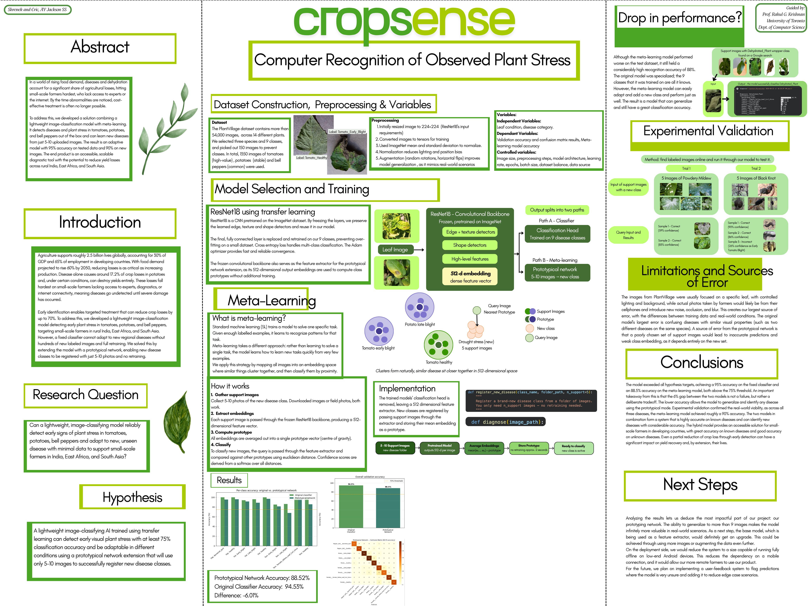
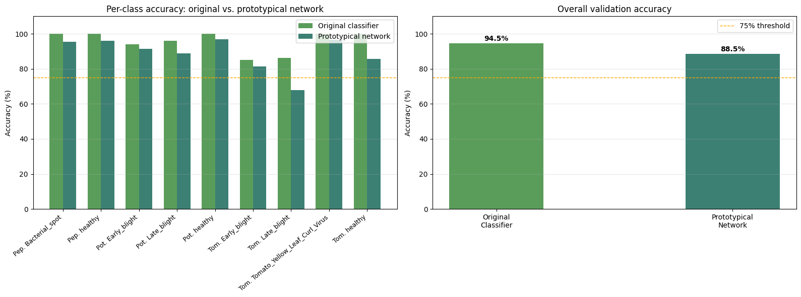

# plant-disease-recognition

**CropSense: Computer Recognition of Observed Plant Stress**

A CNN based meta-learning model that specialises in southern Asian crops. It detects diseases and plant stress in tomatoes, potatoes and bell peppers out of the box, and can learn new diseases from just 5-10 uploaded images.

**Silver medal, Toronto Science Fair 2026.** By Shrenik Subbaiyan and Eric, A.Y. Jackson Secondary School. Guided by Prof. Rahul G. Krishnan, Department of Computer Science, University of Toronto.



## Why

In a world of rising food demand, diseases and dehydration account for a significant share of agricultural losses, hitting small-scale farmers hardest, who lack access to experts or the internet. By the time abnormalities are noticed, cost-effective treatment is often no longer possible.

A fixed classifier can't adapt to new regional diseases without hundreds of new labelled images and full retraining. We solved this by extending the model with a prototypical network, so a new disease can be registered with just 5-10 photos and no retraining.

**Research question:** Can a lightweight image-classifying model reliably detect early signs of plant stress in tomatoes, potatoes and bell peppers, and adapt to new, unseen diseases with minimal data, to support small-scale farmers in India, East Africa and South Asia?

**Hypothesis:** A lightweight image-classifying AI trained using transfer learning can detect early visual plant stress with at least 75% classification accuracy, and be adaptable to different conditions using a prototypical network extension that uses only 5-10 images to register new disease classes.

## How it works

1. **Dataset.** The [PlantVillage dataset](https://github.com/spMohanty/PlantVillage-Dataset) has more than 54,000 images across 14 plants. We picked 3 species and 9 classes, and 150 images per class to prevent bias: tomatoes (high-value), potatoes (stable) and bell peppers (common). 1,350 images in total, split 80/20 into training and validation.
2. **Preprocessing.** Resize to 224x224 (ResNet18's input size), convert to tensors, normalize with ImageNet's mean and standard deviation, and augment with random rotations and horizontal flips to mimic real-world photos.
3. **ResNet18 with transfer learning.** ResNet18 is a CNN pretrained on ImageNet. Freezing its layers keeps the edge, texture and shape detectors it already learned. Only the final layer is replaced and retrained on our 9 classes, with cross-entropy loss and the Adam optimizer.
4. **Meta-learning (prototypical network).** The classification layer is removed, leaving a 512-number embedding, like a fingerprint for the leaf image. Each disease's prototype is the average fingerprint of its support images, the centre of gravity for what that disease looks like in 512-dimensional space. A new image is classified by the nearest prototype (Euclidean distance), with confidence scores from a softmax over the distances.

Adding a new disease is one call:

```python
register_new_disease('powdery_mildew', 'path/to/5_photos')
diagnose('path/to/new_leaf.jpg')
```

## Results

| Model | Validation accuracy |
| --- | --- |
| Original classifier (9 fixed classes) | 94.53% |
| Prototypical network (meta-learning) | 88.52% |

Both beat the 75% target. The 6% gap isn't a failure but a deliberate tradeoff: the lower accuracy lets the model generalize and identify any disease using the prototypical mode.



**Testing on new diseases.** We found labelled images online, registered each as a new class from 5 support images, and ran unseen images through the model:

- Powdery mildew: both test images classified correctly (59% and 85% confidence).
- Black knot: 2 of 3 correct (90% and 86% confidence); one was misread as tomato early blight.
- Dehydrated plant: 2 of 3 test images correct.

## Limitations

- PlantVillage photos are focused on a single leaf with controlled lighting and background. Real photos taken by farmers on their phones would have noise, occlusion and blur, which is our largest source of error.
- The original model's biggest error is confusing diseases that look alike, such as two different diseases on the same species (tomato early blight vs late blight).
- The prototypical network depends entirely on its support images: a poorly chosen set leads to inaccurate predictions.

## Next steps

- Upgrade the base model used as the feature extractor, with more images or more augmentation.
- Shrink it to run fully offline on low-end Android phones, so farmers don't need a connection.
- Add a user-feedback system that flags predictions the model is unsure about.

## Run it

The notebook was built in Google Colab. It clones PlantVillage, builds the balanced 9-class dataset and trains the classifier. Paths like `/content/drive/MyDrive/...` point to my Google Drive, so change them to your own folders.

```bash
pip install -r requirements.txt
jupyter notebook notebooks/plant_disease_classification.ipynb
```

## Files

- `notebooks/plant_disease_classification.ipynb`: training, the prototypical network and evaluation
- `images/`: accuracy charts and confusion matrices from the notebook
- `poster/`: our Toronto Science Fair poster

Built with help from AI tools.
